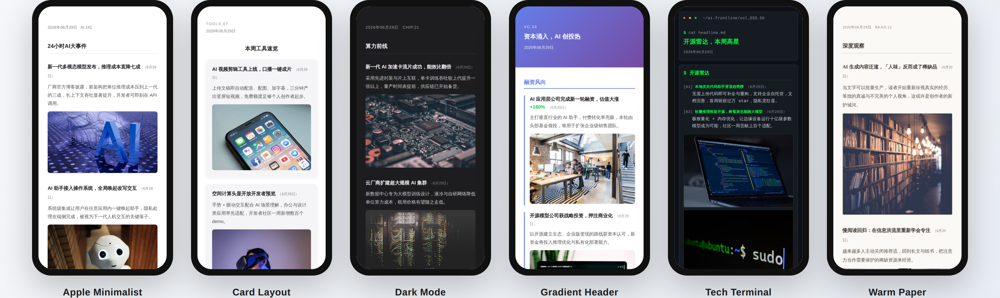
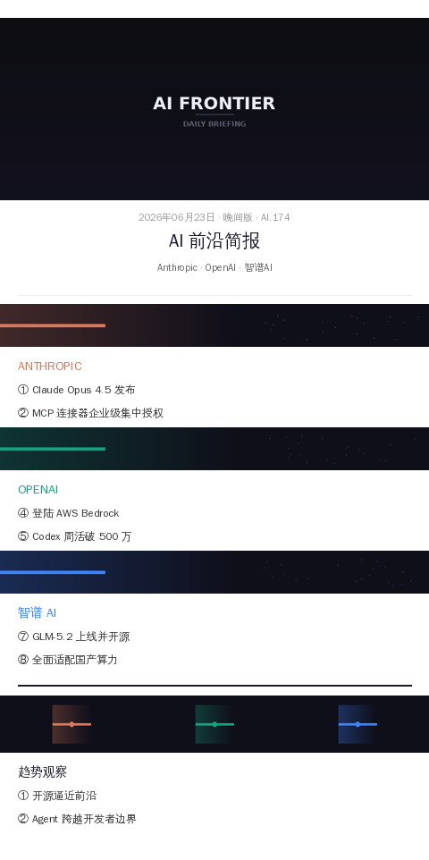

# wechat-ai-briefing

> A pluggable WeChat Official Account article template gallery with a Python publisher that auto-creates drafts via the WeChat MP API.

> 一套可插拔的微信公众号文章排版模板，配合 Python 发布脚本，自动创建草稿到公众号后台。

中文 | [English](README.md)

---

## Preview



6 styles, same content data, switch with one field:

| Template | Style | Background | Best For |
|----------|-------|------------|----------|
| apple-minimalist | Apple minimalism | White #FFFFFF | Tech news, daily briefings |
| dark-mode | Dark mode | Dark #1D1D1F | Tech blogs, developer newsletters |
| warm-paper | Warm journal | Cream #FAF9F5 | Humanities, long-form reading |
| card-layout | Card layout | White + gray cards | Product updates, multi-column |
| gradient-header | Gradient header | Purple gradient + white | Brand promotion, event previews |
| tech-terminal | Terminal style | GitHub Dark | Geek culture, open-source projects |

Live preview (Apple Minimalist · AI Briefing):



## Features

- 6 built-in templates, switch via `"style"` field
- Pluggable: drop a `composer.py` into `templates/your-style/` and it works
- Shared utilities in `templates/_shared.py`: `colorUpDown` (green up / red down), `parse_item` (title/body/date parsing)
- Unified JSON input — switch templates without rewriting content
- Auto-upload inline images to WeChat image hosting
- Auto-crop cover to 900x383
- Finance data auto-coloring (green up, red down)
- Lazy credential loading — import without auth
- config.json for personal defaults (author, default template)
- Pure stdlib + Pillow, zero external dependencies

## Quickstart

```bash
# 1. Install dependencies
pip install -r requirements.txt

# 2. Configure credentials
cp creds.example.py creds.py
# Edit creds.py with your AppID and AppSecret

# 3. (Optional) Configure personal defaults
cp config.example.json config.json
# Edit config.json to set author name and default template

# 4. Publish (creates a draft)
python3 publish_generic.py templates/apple-minimalist/example.json
```

Output:
```json
{"success": true, "draft_id": "BONXQtyHTyt...", "style": "apple-minimalist",
 "message": "草稿创建成功，请到公众号后台手动发布"}
```

Log in to mp.weixin.qq.com → Content Management → Drafts → Publish manually.

## Input Format

See [README.md](README.md) for full JSON schema documentation.

## Custom Template

Create `templates/your-style/composer.py` and import shared utilities:

```python
"""Your custom style — describe the aesthetic here."""
import os, sys, time
sys.path.insert(0, os.path.dirname(os.path.dirname(os.path.abspath(__file__))))
from _shared import colorUpDown, parse_item


def compose_html(article_data, image_urls):
    today = time.strftime("%Y年%m月%d日")
    sections = article_data.get("sections", [])
    parts = [f'<section style="background:#FFF;padding:30px;"><p>{today}</p>']

    for section in sections:
        parts.append(f'<p style="font-size:18px;font-weight:bold;">{section["heading"]}</p>')
        for item in section.get("items", []):
            head, body, date_str = parse_item(item)
            parts.append(f'<p style="font-size:16px;">{head}</p>')
            if body:
                parts.append(f'<p style="font-size:15px;">{body}</p>')

    parts.append('</section>')
    return "\n".join(parts)
```

Set `"style": "your-style"` in the JSON to use it.

## Project Layout

```
wechat-ai-briefing/
├── publish_generic.py       # Publisher (main entry point)
├── clean_drafts.py          # Batch draft cleanup tool
├── creds.example.py         # Credential template
├── config.example.json      # Personal defaults template (author, default style)
├── requirements.txt         # Python dependencies
├── templates/               # Template gallery
│   ├── _shared.py           # Shared utilities (colorUpDown, parse_item)
│   ├── apple-minimalist/    # Apple minimalism
│   ├── dark-mode/           # Dark mode
│   ├── warm-paper/          # Warm journal
│   ├── card-layout/         # Card layout
│   ├── gradient-header/     # Gradient header
│   └── tech-terminal/       # Terminal style
├── examples/                # Full article examples
└── docs/
    └── images/              # Template preview images
```

## Known Limitations

- **Personal subscription accounts cannot publish via API** — returns 48001. Drafts must be published manually. This is a platform limitation.
- **IP whitelist** — server IP must be added at mp.weixin.qq.com → Settings → Basic Config → IP Whitelist.
- **Image upload limits** — Inline images use `/media/uploadimg` (no quota), covers use `/material/add_material` (counts against permanent media quota).

## License

MIT — use freely, no warranty.
