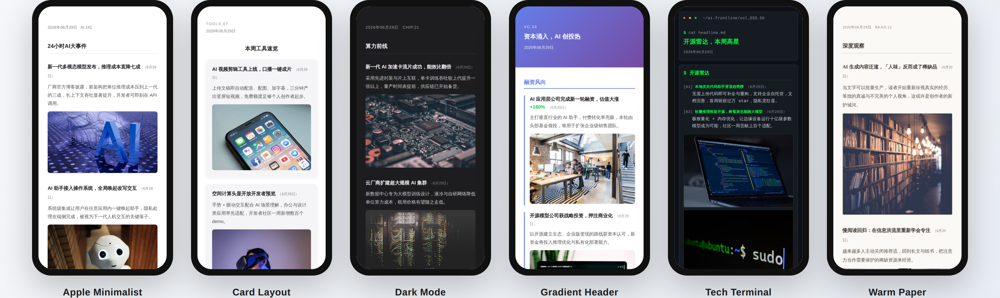
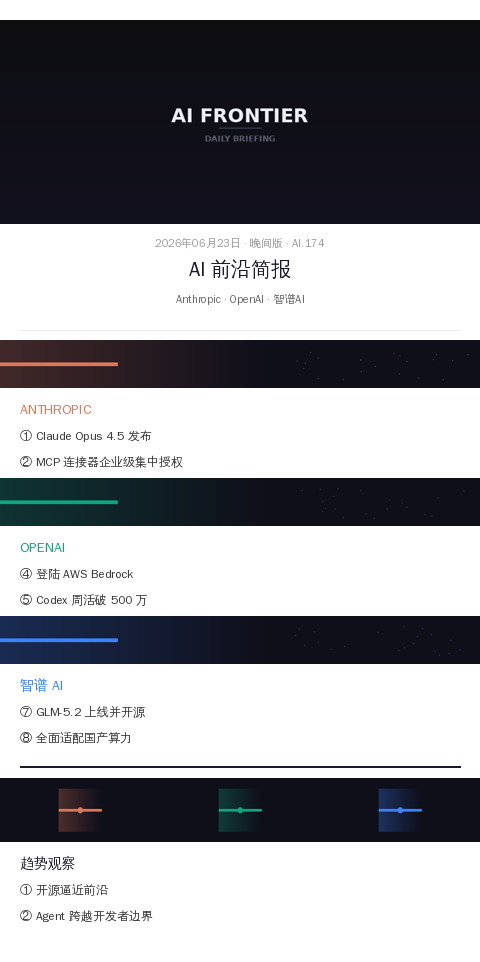

# wechat-oa-templates

> 一套可插拔的微信公众号文章排版模板，配合 Python 发布脚本，自动创建草稿到公众号后台。

> A pluggable WeChat Official Account article template gallery with a Python publisher that auto-creates drafts via the WeChat MP API.

[English](README.en.md) | 中文

---

## 预览 Preview



6 种风格，同一份内容数据，一键切换：

| 模板 | 风格 | 背景 | 适合场景 |
|------|------|------|----------|
| apple-minimalist | Apple 极简风 | 纯白 #FFFFFF | 科技资讯、每日简报 |
| dark-mode | 暗黑模式 | 深色 #1D1D1F | 技术博客、开发者周刊 |
| warm-paper | 暖纸期刊风 | 米色 #FAF9F5 | 人文、深度阅读 |
| card-layout | 卡片布局 | 白底 + 灰卡 | 产品更新、多栏目 |
| gradient-header | 渐变头部 | 紫色渐变 + 白底 | 品牌推广、活动预告 |
| tech-terminal | 终端风格 | GitHub Dark | 极客文化、开源项目 |

实际效果（Apple 极简风 · AI 简报）：



## 特性 Features

- 6 种内置模板，`"style"` 字段一键切换
- 模板可插拔：放一个 `composer.py` 到 `templates/your-style/` 即可
- 共享工具模块 `templates/_shared.py`：`colorUpDown`（涨绿跌红）、`parse_item`（标题/正文/日期解析）
- 统一 JSON 输入格式，模板间无缝切换
- 自动上传内联图片到微信图床
- 封面自动裁剪 900x383
- 美股/财经数据自动标色（涨绿跌红）
- 凭证懒加载，import 不触发认证
- config.json 个人默认值（署名、默认模板）
- 纯标准库 + Pillow，零外部依赖

## 快速开始 Quickstart

```bash
# 1. 安装依赖
pip install -r requirements.txt

# 2. 配置凭证
cp creds.example.py creds.py
# 编辑 creds.py，填入你的 AppID 和 AppSecret

# 3. (可选) 配置个人默认值
cp config.example.json config.json
# 编辑 config.json，设置署名和默认模板

# 4. 发布文章（创建草稿）
python3 publish_generic.py templates/apple-minimalist/example.json
```

输出：
```json
{"success": true, "draft_id": "BONXQtyHTyt...", "style": "apple-minimalist",
 "message": "草稿创建成功，请到公众号后台手动发布"}
```

登录 mp.weixin.qq.com → 内容管理 → 草稿箱 → 手动发布。

## 输入格式 Input Format

```json
{
  "style": "apple-minimalist",
  "title": "新闻关键词，一句解读",
  "digest": "一句话摘要",
  "author": "你的署名",
  "vol": "AI.001",
  "cover": {
    "bg_image": "https://example.com/cover-image.jpg"
  },
  "sections": [
    {
      "heading": "前沿速递",
      "items": [
        "标题<br/>正文内容，150-250字。（6月27日）"
      ],
      "images": [
        "https://example.com/article-image.jpg"
      ],
      "sources": [
        "https://example.com/original-news-source"
      ]
    }
  ],
  "trends": [
    "趋势1：分析+影响",
    "趋势2：分析+影响"
  ]
}
```

| 字段 | 类型 | 必填 | 说明 |
|------|------|------|------|
| style | string | 否 | 模板名，默认读 config.json → apple-minimalist |
| title | string | 是 | 文章标题 |
| digest | string | 否 | 摘要，显示在消息列表 |
| author | string | 否 | 署名，默认读 config.json → 环境变量 WECHAT_AUTHOR → "Your Name" |
| vol | string | 否 | 期号，如 "AI.001"，显示在标题栏 |
| cover.bg_image | string | 否 | 封面图 URL，自动裁剪 900x383 |
| sections[].heading | string | 是 | 栏目标题 |
| sections[].items[] | string | 是 | 正文，用 `<br/>` 分隔标题和正文，末尾可附日期 |
| sections[].images[] | string | 否 | 内联图片 URL，与 items 等长 |
| sections[].sources[] | string | 否 | 原始来源 URL，与 items 等长，供 fact_check.py 核验 |
| trends[] | string | 否 | 趋势观察栏目 |

## 自定义模板 Custom Template

创建 `templates/your-style/composer.py`，导入共享工具：

```python
"""Your custom style — describe the aesthetic here."""
import os, sys, time
sys.path.insert(0, os.path.dirname(os.path.dirname(os.path.abspath(__file__))))
from _shared import colorUpDown, parse_item


def compose_html(article_data, image_urls):
    today = time.strftime("%Y年%m月%d日")
    sections = article_data.get("sections", [])
    parts = [f'<section style="background:#FFF;padding:30px;"><p>{today}</p>']

    for section in sections:
        parts.append(f'<p style="font-size:18px;font-weight:bold;">{section["heading"]}</p>')
        for item in section.get("items", []):
            head, body, date_str = parse_item(item)
            parts.append(f'<p style="font-size:16px;">{head}</p>')
            if body:
                parts.append(f'<p style="font-size:15px;">{body}</p>')

    parts.append('</section>')
    return "\n".join(parts)
```

### 共享工具 _shared.py

| 函数 | 说明 |
|------|------|
| `colorUpDown(text)` | 将 `+5.2%` 标绿、`-3.1%` 标红 |
| `parse_item(raw)` | 解析 `"标题<br/>正文（6月27日）"` → `(head, body, date_str)`，自动应用 colorUpDown |

JSON 中设 `"style": "your-style"` 即可使用。

### 微信 CSS 限制

- 只能用 inline style (`style="..."`)
- 不能用 `position` / `flex` / `grid` / `display`
- 不能用 `<style>` 块和 `<script>`
- 可用标签：`<section>`, `<p>`, `<span>`, ``
- 可用属性：`background-color`, `padding`, `margin`, `border`, `font-size`, `color`, `text-align`, `border-radius`, `box-shadow`

## 自动化 Automation

### Crontab
```bash
# 每天 10:00 发布 AI 简报
0 10 * * * cd /path/to/wechat_publisher && python3 publish_generic.py /tmp/today_ai.json
```

### AI Agent
配合 AI Agent（如 Hermes Agent）自动搜索新闻、生成 JSON、调用脚本。详见 [examples/](examples/) 目录。

### GitHub Actions
注意：GitHub Runner IP 不固定，无法加入微信 IP 白名单。建议用自建服务器或本地 cron。

## 质控闸门 Quality Gates

发布前的自动化质检脚本，全部遵循统一约定：**`exit 0` 才放行，非 0 即阻断发布**。可单独运行，也可串进 AI Agent / cron 的发布流程。

| 脚本 | 作用 | 用法 |
| --- | --- | --- |
| `typo_check.py` | 中文错别字 3 轮扫描（已知错误模式 + 逐字段审查 + 文档special检查） | `python3 typo_check.py [project_dir]` |
| `check_image_source.py` | 配图 3 轮校验（① 水印源黑/灰/白名单 ② 高清分辨率+体积 ③ HTTP 可达+真图可解码） | `python3 check_image_source.py article.json [--strict] [--no-network]` |
| `fact_check.py` | 事实核验 3 轮闸门（① 来源完备 ② 来源可达 ③ 内容印证，抓取来源正文核对新闻锚点，治幻觉式新闻） | `python3 fact_check.py article.json [--strict] [--no-network]` |
| `topic_memory.py` | 选题记忆库 —— 跨天去重 + 主题多样性，避免选题同质化 | 生成前 `python3 topic_memory.py recent [N]`；发布后 `python3 topic_memory.py add article.json` |

> 三个核验脚本（`check_image_source.py` / `fact_check.py` / `topic_memory.py`）依赖 `requests` 和 `Pillow`（见 requirements.txt）。`fact_check.py` 要求文章 JSON 的每个 section 增加与 `items` 等长的 `sources` 数组（每条新闻的原始来源 URL）。`topic_memory.py` 的数据文件 `topic_memory.json` 因号而异，不纳入版本库。

## 已知限制 Known Limitations

- **个人订阅号不能 API 直接发布** — 返回 48001，只能创建草稿后手动发布。这是平台限制，不是 bug。
- **IP 白名单** — 服务器 IP 必须加入 mp.weixin.qq.com → 设置与开发 → 基本配置 → IP 白名单。
- **图片上传限制** — 内联图片用 `/media/uploadimg`（不占素材库配额），封面用 `/material/add_material`（占永久素材配额）。

## 项目结构 Project Layout

```
wechat-oa-templates/
├── publish_generic.py       # 发布脚本 (主入口)
├── typo_check.py            # 质控闸门：中文错别字 3 轮扫描
├── check_image_source.py    # 质控闸门：配图 3 轮校验 (水印/高清/可达)
├── fact_check.py            # 质控闸门：事实核验 3 轮 (来源完备/可达/内容印证)
├── topic_memory.py          # 质控闸门：选题记忆库 (去重 + 多样性)
├── clean_drafts.py          # 草稿批量清理工具
├── creds.example.py         # 凭证模板
├── config.example.json      # 个人默认值模板 (署名、默认模板)
├── requirements.txt         # Python 依赖
├── templates/               # 模板画廊
│   ├── _shared.py           # 共享工具 (colorUpDown, parse_item)
│   ├── apple-minimalist/    # Apple 极简风
│   ├── dark-mode/           # 暗黑模式
│   ├── warm-paper/          # 暖纸期刊风
│   ├── card-layout/         # 卡片布局
│   ├── gradient-header/     # 渐变头部
│   └── tech-terminal/       # 终端风格
├── examples/                # 完整文章示例
└── docs/
    └── images/              # 模板预览图
```

## 贡献模板 Contributing

欢迎提交新模板！每个模板需要：

1. `templates/your-style/composer.py` — 定义 `compose_html(article_data, image_urls) -> str`，从 `_shared` 导入工具
2. `templates/your-style/example.json` — 示例文章
3. `templates/your-style/README.md` — 风格说明、配色表

## License

MIT — 随便用，不负责。
